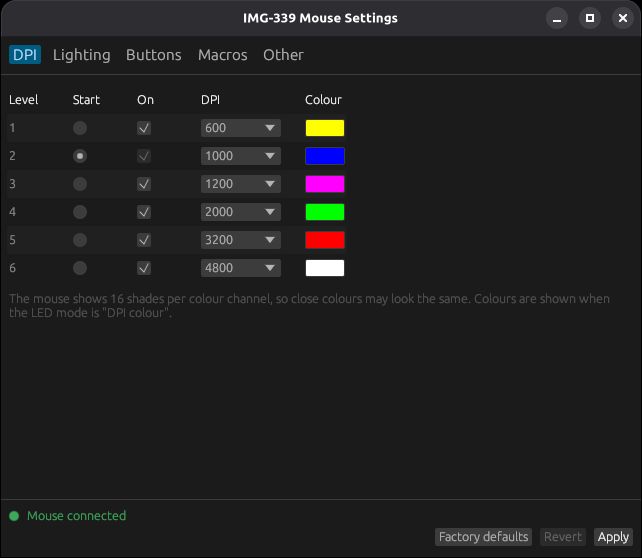

# img339ctl

[Türkçe](README.md) | **English**

Configure the **Inca IMG-339** gaming mouse on Linux, without the vendor's
Windows software. Comes as a command line tool (`img339ctl`) and a graphical
app (`img339ctl-gui`).

> **macOS support is experimental** (Apple Silicon and Intel Macs, macOS 11 or newer).
> The program builds for the Mac but has not been tried with the mouse on a real Mac
> yet, so it may not work. If you try it, please
> report what happens so it can be fixed: [macOS (experimental)](#macos-experimental).



```
$ img339ctl dpi 1 1600
$ img339ctl color 1 ff8000
$ img339ctl led dpi
$ img339ctl button 4 dpi-
$ img339ctl status
Mouse: /dev/hidraw3
Profile: /home/you/.config/img339ctl/profile.ini
DPI levels:
  1: 1600 dpi  on   #ff8000
 *2: 1000 dpi  on   #0000ff
  ...
Buttons:
  ...
  4: dpi-
  ...
LED: dpi, cycle 2 s, cycle colours 1 2 3 4 5 6 7
```

- 6 DPI levels (200-4800), each with its own LED colour, enable/disable and start level
- LED modes: DPI colour, colour cycle (1-6 s, choose the colours), static, off
- Remap all 7 buttons: mouse buttons, DPI±, double click, rapid fire, disable, ...
- Media keys, shortcuts, macros and commands through a small daemon
- Wheel as scroll or volume, rapid-fire interval
- GUI in English and Turkish, on Wayland and X11

## Where to buy

The IMG-339 is available on Hepsiburada (Turkey):
**[IMG-339 silent gaming mouse on Hepsiburada](https://www.hepsiburada.com/ari-img-339-sessiz-gaming-mouse-p-HBCV0000OV9ASQ?magaza=ARI%20B%C4%B0L%C4%B0%C5%9E%C4%B0M%20%C4%B0LET%C4%B0%C5%9E%C4%B0M%20VE%20DANI%C5%9EMANLIK)**

## Supported hardware

| Device | USB ID | Status |
|---|---|---|
| Inca IMG-339 | `18f8:0fc0` | tested |
| Inca IMG-339 (other revision) | `18f8:1086` | untested |
| Inca IMG-GT12 | ? | **may work, please test** |

`lsusb` shows the mouse as `[Maxxter] USB GAMING MOUSE`.

There is a separate tool for the Inca IMG-355GX:
[Inca-IMG355GX-Linux](https://github.com/EmreYavuzalp/Inca-IMG355GX-Linux).

### Inca IMG-GT12 and other similar mice

The **Inca IMG-GT12** uses very similar hardware and will probably work too, but
it has not been tested yet. If you have one, please try it and report back in an
issue, whether it works or not:

1. Run `lsusb` and note the mouse's ID. If it is `18f8:0fc0` or `18f8:1086`,
   `img339ctl status` should find it right away.
2. Try a harmless, visible change, for example `img339ctl color 1 red` followed
   by `img339ctl led dpi`, and check the DPI button and side buttons.
3. Open an issue with the `lsusb` line and what did or did not work.

If the ID is different, the mouse is not detected automatically. Testers can
point the tool at it by hand with `--device /dev/hidrawN`; the udev rule must
then also list the new ID. Please include the ID in the issue so it can be added.

## Install

### Ubuntu, Linux Mint, Debian (easiest)

Download `img339ctl_..._amd64.deb` from the latest
[release](https://github.com/EmreYavuzalp/Inca-IMG339-Linux/releases) and
**double-click** it, or:

```sh
sudo apt install ./img339ctl_*_amd64.deb
```

Re-plug the mouse afterwards; the menu shows **IMG-339 Mouse Settings**. Mouse
access is set up by the package. To uninstall: `sudo apt remove img339ctl`

### Other distributions

Download `img339ctl-...-x86_64-linux.tar.gz` from the release, then:

```sh
tar xzf img339ctl-*-x86_64-linux.tar.gz
cd img339ctl-*-x86_64-linux
./install.sh
```

`install.sh` installs both programs to `~/.local/bin`, adds the menu entry and
installs the udev rule (asks for your sudo password). Re-plug the mouse
afterwards.

**Tested and working on Debian 13 and Devuan 6.** The prebuilt binaries are built to also run on Debian 11,
Ubuntu 20.04, Linux Mint 20 and newer (64-bit Intel/AMD).

### From source

Requires Rust 1.81 or newer.

```sh
git clone https://github.com/EmreYavuzalp/Inca-IMG339-Linux
cd Inca-IMG339-Linux
cargo install --path . --root ~/.local                  # CLI only: ~/.local/bin/img339ctl
cargo install --path . --root ~/.local --features gui   # CLI and GUI: also img339ctl-gui
```

For the GUI's menu entry:

```sh
install -Dm 644 contrib/img339ctl-gui.desktop ~/.local/share/applications/img339ctl-gui.desktop
```

The GUI needs OpenGL and, at run time, the usual Wayland or X11 libraries
(`libxkbcommon`, `libwayland-client` or `libX11`); no development packages are
needed to build it.

Allow your user to access the mouse (otherwise only root can), then plug it in again:

```sh
sudo install -m 644 contrib/70-img339-mouse.rules /etc/udev/rules.d/
sudo udevadm control --reload-rules
```

Man page:

```sh
install -Dm 644 man/img339ctl.1 ~/.local/share/man/man1/img339ctl.1
man img339ctl
```

## macOS (experimental)

This build **has not been tried with the mouse on a real Mac yet**. It is built for
Apple Silicon and Intel Macs. It has no Apple signature, so macOS blocks it at first.

1. Download `img339ctl-...-macos.zip` from the [latest release](https://github.com/EmreYavuzalp/Inca-IMG339-Linux/releases/latest) and unpack it.
2. Drag `IMG-339.app` to **Applications**.
3. Remove the block in Terminal:

   ```sh
   xattr -dr com.apple.quarantine /Applications/IMG-339.app
   ```

For media keys and macros, start the background service with the button in the app;
it does not start by itself when the Mac boots. `MACOS-TEST.md` in the zip lists what
to try. Whether it works or not, please report the result in an [issue](https://github.com/EmreYavuzalp/Inca-IMG339-Linux/issues).

## Graphical app

`img339ctl-gui` edits the same profile as the CLI. Change DPI levels, colours,
LED mode, buttons and macros, then press **Apply** to send them to the mouse.
**Revert** goes back to the last applied settings, **Factory defaults** loads the
vendor defaults (press Apply to send them). The status bar shows whether the
mouse is connected and, if some button needs it, starts the background service.
The current DPI appears there and at the top of the DPI tab, and follows the DPI
buttons on the mouse. Without the background service it reads "unknown" until the
first DPI button press or Apply after the window opens, because the mouse only
reports its level when a button is pressed.
The interface is in Turkish when `LANG` is `tr_*`, English otherwise.

## Usage

Every command that changes a setting saves it to
`~/.config/img339ctl/profile.ini` and sends the whole profile to the mouse. The
mouse keeps its settings when unplugged. It cannot report them back, so the
profile file is the reference; `img339ctl apply` sends it again.

| Command | |
|---|---|
| `img339ctl status` | detected mouse, current settings and, with the daemon running, the current DPI |
| `img339ctl dpi LEVEL VALUE` | set a level (1-6) to 200/400/600/800/1000/1200/1600/2000/2400/3200/4000/4800 |
| `img339ctl dpi LEVEL --off` / `--on` / `--active` | skip a level, re-enable it, start in it |
| `img339ctl color LEVEL COLOR` | `ff8000`, `#f80`, or a name: red, orange, cyan, ... |
| `img339ctl led dpi\|cycle\|static\|off [--time S] [--colors "1 3 5"]` | LED mode |
| `img339ctl button N ACTION` | bind a button, see `img339ctl actions` |
| `img339ctl fire MS` | rapid-fire interval |
| `img339ctl wheel scroll\|volume` | wheel function |
| `img339ctl macro NAME STEPS...` | define a macro |
| `img339ctl reset` | factory defaults |
| `img339ctl -n ...` | dry run: print the USB reports instead of sending them |

Buttons are numbered as in the vendor software: 1 left, 2 middle, 3 right,
4 forward, 5 back, 6 DPI+, 7 DPI- by default.

### Starting automatically

With the `.deb` package the background service starts by itself. At login and each time
the mouse is plugged in it writes the saved settings to the mouse, and media keys and
macros are ready to use. If nothing has been saved yet, it leaves the mouse's settings
alone. To turn it off and back on:

```sh
systemctl --user mask --now img339ctl.service
systemctl --user unmask img339ctl.service && systemctl --user start img339ctl.service
```

With other installs, enable the service yourself:

```sh
mkdir -p ~/.config/systemd/user
cp contrib/img339ctl.service ~/.config/systemd/user/
systemctl --user enable --now img339ctl.service
```

### Media keys, shortcuts and macros

Functions such as `volume-up`, `copy`, `keys:ctrl+shift+t`, `macro:NAME` or
`run:COMMAND` are not executed by the mouse. It only reports the button press, and
`img339ctl daemon` answers by making the mouse type the keys. Because the
keystrokes come from the mouse itself, they work everywhere: X11, Wayland, the
console.

```sh
img339ctl macro hello text:hello space text:world enter
img339ctl button 5 macro:hello          # once; macro:hello:3 or macro:hello:hold also work
img339ctl button 4 volume-up
img339ctl daemon                         # the .deb's service already runs it
```

Run `img339ctl actions` for the full list and the macro syntax, or see
`man img339ctl`.

## Troubleshooting

- **Black window:** on very old GPUs (e.g. 2010-era Intel HD Graphics) the app
  detects this and restarts itself with software OpenGL. If it stays black, try
  `LIBGL_ALWAYS_SOFTWARE=1 img339ctl-gui`.
- **Verbose log:** `IMG339_LOG=debug img339ctl-gui` prints graphics driver and UI
  messages to the terminal; please include it in bug reports.
- **"no permission to open /dev/hidraw…":** the udev rule is missing or was
  installed while the mouse was plugged in; re-plug the mouse.

## Tested on hardware

Systems confirmed to work:

- **Debian 13** (systemd, GNOME, Wayland and X11)
- **Devuan 6** (no systemd: runit and elogind, GNOME Wayland). Mouse access is
  set up without systemd; on an old Intel GPU the GUI switches to software
  OpenGL by itself and opens fine.

Features tested with a `18f8:0fc0` mouse:

- DPI values, disabling a level, per-level colours, static colour, LED off
- button remapping (DPI-), media key (volume up) and keyboard macros

Not yet confirmed: the rapid-fire function and the second USB ID.

## Development

```sh
cargo test
cargo run -- -n reset
cargo run --features gui --bin img339ctl-gui
```

## License

[BSD-3-Clause](LICENSE). Not affiliated with Inca. The vendor software is not included.
