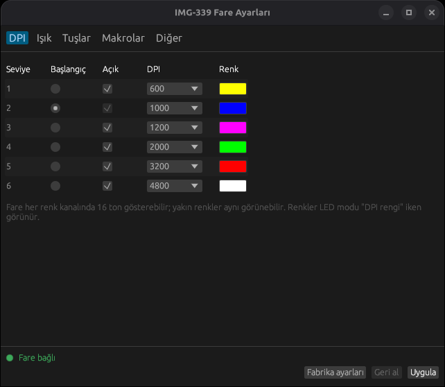
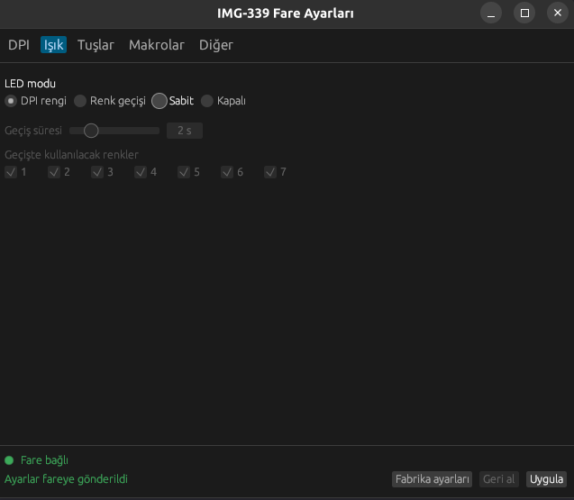
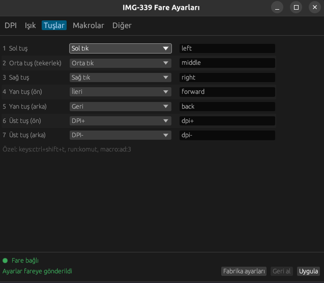
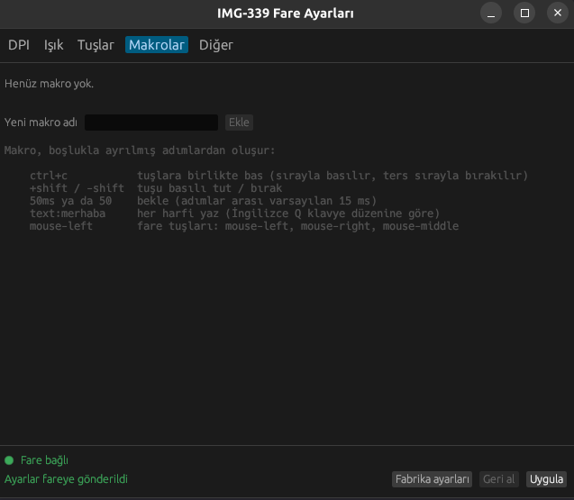

# img339ctl

**Türkçe** | [English](README.en.md)

**Inca IMG-339** oyuncu faresini Linux'ta, üreticinin Windows programına gerek
kalmadan ayarlayın. Hem komut satırı aracı (`img339ctl`) hem de Türkçe arayüzlü
bir pencere uygulaması (`img339ctl-gui`) olarak gelir.

> **macOS için deneysel destek vardır** (M serisi ve Intel Mac'ler, macOS 11 ve sonrası).
> Program Mac için derleniyor, ama henüz gerçek bir Mac'te fareyle denenmedi; çalışmayabilir. Denerseniz sonucu bildirin, ona göre
> düzeltelim: [macOS (deneysel)](#macos-deneysel).

<p>
  
  
  
  
</p>

## Neler yapabilir?

- 6 DPI seviyesi (200-4800): her birine ayrı LED rengi, açma/kapama, başlangıç seviyesi
- LED modları: DPI rengi, renk geçişi (1-6 sn, renkleri siz seçin), sabit, kapalı
- 7 tuşun tamamına işlev atama: sol/orta/sağ tık, ileri/geri, DPI+/-, çift tık, seri tık (fire), tuşu kapatma...
- Medya tuşları (ses, oynat/duraklat...), kısayollar (kopyala, yapıştır...), makrolar ve komut çalıştırma
- Tekerleği kaydırma ya da ses ayarı olarak kullanma
- Wayland ve X11'de çalışır. Arayüz sistem diliniz Türkçeyse Türkçe açılır.

## Satın al

IMG-339'u Hepsiburada'dan alabilirsiniz:
**[IMG-339 Sessiz Gaming Mouse, Hepsiburada](https://www.hepsiburada.com/ari-img-339-sessiz-gaming-mouse-p-HBCV0000OV9ASQ?magaza=ARI%20B%C4%B0L%C4%B0%C5%9E%C4%B0M%20%C4%B0LET%C4%B0%C5%9E%C4%B0M%20VE%20DANI%C5%9EMANLIK)**

## Desteklenen fareler

| Fare | USB kimliği | Durum |
|---|---|---|
| Inca IMG-339 | `18f8:0fc0` | test edildi |
| Inca IMG-339 (diğer sürüm) | `18f8:1086` | test edilmedi |
| Inca IMG-GT12 | ? | **büyük ihtimalle çalışır, test edin** |

Farenizin kimliğini görmek için terminalde `lsusb` yazın. IMG-339
`[Maxxter] USB GAMING MOUSE` olarak görünür.

Inca IMG-355GX için ayrı bir araç var:
[Inca-IMG355GX-Linux](https://github.com/EmreYavuzalp/Inca-IMG355GX-Linux).

### Inca IMG-GT12 sahiplerine çağrı

**Inca IMG-GT12** çok benzer bir donanım kullanıyor ve büyük ihtimalle bu araçla
çalışır, ama henüz kimse denemedi. Elinizde varsa lütfen deneyin ve çalışsa da
çalışmasa da sonucu bir [issue](https://github.com/EmreYavuzalp/Inca-IMG339-Linux/issues)
olarak bildirin:

1. `lsusb` yazın ve farenin satırını not edin. Kimlik `18f8:0fc0` ya da
   `18f8:1086` ise `img339ctl status` fareyi hemen bulmalı.
2. Zararsız ve gözle görülür bir değişiklik deneyin, örneğin
   `img339ctl color 1 red` ve ardından `img339ctl led dpi`. DPI düğmesini ve yan
   tuşları da kontrol edin.
3. `lsusb` satırını ve neyin çalışıp neyin çalışmadığını issue'ya yazın.

Kimlik farklıysa fare otomatik bulunmaz. Denemek için `--device /dev/hidrawN`
ile elle gösterebilirsiniz, bu durumda udev kuralına da yeni kimliği eklemeniz
gerekir. Issue'ya kimliği yazarsanız desteğini ekleriz.

## Kurulum

### Ubuntu, Linux Mint, Debian (en kolayı)

[Releases](https://github.com/EmreYavuzalp/Inca-IMG339-Linux/releases) sayfasından
son sürümün `img339ctl_..._amd64.deb` dosyasını indirin, **çift tıklayın** ve
**Yükle**'ye basın. Terminali tercih ederseniz:

```sh
sudo apt install ./img339ctl_*_amd64.deb
```

Kurulumdan sonra fareyi çıkarıp tekrar takın. Menüde **IMG-339 Fare Ayarları**
görünür. Fare izni kurulum sırasında otomatik ayarlanır. Kaldırmak için:
`sudo apt remove img339ctl`

### Diğer dağıtımlar

Releases sayfasından `img339ctl-...-x86_64-linux.tar.gz` dosyasını indirin, sonra:

```sh
tar xzf img339ctl-*-x86_64-linux.tar.gz
cd img339ctl-*-x86_64-linux
./install.sh
```

`install.sh` programları `~/.local/bin` altına kurar, uygulama menüsüne ekler ve
fareye erişim için udev kuralını kurar (bunun için sudo şifresi sorar). Ardından
fareyi çıkarıp tekrar takın.

**Debian 13 ve Devuan 6'da test edildi, ikisinde de çalışıyor.** Hazır dosyalar Debian 11, Ubuntu 20.04, Linux Mint 20
ve sonraki sürümlerde de çalışacak şekilde derlenir (64 bit Intel/AMD).

### Kaynaktan derleyerek

Rust 1.81 ya da daha yenisi gerekir. Debian/Ubuntu'da: `sudo apt install cargo`

```sh
git clone https://github.com/EmreYavuzalp/Inca-IMG339-Linux
cd Inca-IMG339-Linux
cargo install --path . --root ~/.local --features gui   # komut satırı + arayüz
# yalnızca komut satırı için: cargo install --path . --root ~/.local
```

**Fareye erişim izni.** Bu adım olmadan fareyi sadece root ayarlayabilir.
Komutları çalıştırdıktan sonra fareyi çıkarıp tekrar takın:

```sh
sudo install -m 644 contrib/70-img339-mouse.rules /etc/udev/rules.d/
sudo udevadm control --reload-rules
```

**Uygulama menüsüne ekleme** (arayüz için):

```sh
install -Dm 644 contrib/img339ctl-gui.desktop ~/.local/share/applications/img339ctl-gui.desktop
```

Artık menüde **IMG-339 Fare Ayarları** görünür. Terminalden `img339ctl-gui`
ile de açabilirsiniz.

**Kılavuz sayfası** (isteğe bağlı):

```sh
install -Dm 644 man/img339ctl.1 ~/.local/share/man/man1/img339ctl.1
man img339ctl
```

Arayüz çalışırken OpenGL ile Wayland ya da X11 kütüphanelerine ihtiyaç duyar.
Bunlar masaüstü kurulu her sistemde zaten vardır. Derlemek için ek geliştirme
paketi gerekmez.

## macOS (deneysel)

Bu sürüm **henüz gerçek bir Mac'te fareyle denenmedi**; M serisi (Apple Silicon) ve
Intel Mac'ler için derleniyor. Apple imzası olmadığı için macOS uygulamayı ilk
açılışta engeller.

1. [Son sürümden](https://github.com/EmreYavuzalp/Inca-IMG339-Linux/releases/latest) `img339ctl-...-macos.zip` dosyasını indirip açın.
2. `IMG-339.app` dosyasını **Uygulamalar** klasörüne sürükleyin.
3. Terminal'de macOS'un engelini kaldırın:

   ```sh
   xattr -dr com.apple.quarantine /Applications/IMG-339.app
   ```

Medya tuşları ve makrolar için arka plan servisini uygulamadaki düğmeyle elle
başlatmanız gerekir, servis Mac açılışında kendiliğinden başlamaz. Zip içindeki
`MACOS-TEST.md` neyi denemeniz gerektiğini adım adım anlatır. Çalışsa da çalışmasa
da sonucu bir [issue](https://github.com/EmreYavuzalp/Inca-IMG339-Linux/issues) ile bildirin.

## Arayüz

`img339ctl-gui` ile DPI seviyelerini, renkleri, LED modunu, tuşları ve
makroları ayarlayıp **Uygula**'ya basın, ayarlar fareye gönderilir.

- **Geri al:** son uygulanan ayarlara döner.
- **Fabrika ayarları:** üreticinin varsayılanlarını yükler. Fareye göndermek için yine Uygula'ya basın.
- **Şu anki DPI:** DPI sekmesinin üstünde ve alt çubukta görünür, fare üzerindeki DPI tuşlarına bastıkça anında değişir. Arka plan servisi çalışmıyorsa, pencere açıldıktan sonraki ilk DPI tuşuna ya da Uygula'ya kadar "bilinmiyor" yazar, çünkü fare seviyesini yalnızca tuşa basılınca bildirir.
- **Alt çubuk:** farenin bağlı olup olmadığını gösterir. Bir tuş arka plan servisine ihtiyaç duyuyorsa servisi başlatan bir düğme çıkar.

Arayüz ve komut satırı aynı ayar dosyasını kullanır, ikisini birlikte
kullanabilirsiniz.

## Komut satırı

Ayar değiştiren her komut, ayarı `~/.config/img339ctl/profile.ini` dosyasına
kaydeder ve tüm profili fareye gönderir. Fare ayarları kendi hafızasında tutar,
çıkarıp takınca kaybolmaz. Fare ayarlarını geri okuyamadığı için asıl kaynak bu
dosyadır. `img339ctl apply` dosyadaki ayarları fareye yeniden gönderir.

| Komut | Ne yapar |
|---|---|
| `img339ctl status` | fare bağlı mı, şu anki ayarlar, arka plan servisi çalışıyorsa şu anki DPI |
| `img339ctl dpi SEVİYE DEĞER` | bir seviyeyi (1-6) 200/400/600/800/1000/1200/1600/2000/2400/3200/4000/4800 yapar |
| `img339ctl dpi SEVİYE --off` / `--on` / `--active` | seviyeyi atlar, geri açar, başlangıç seviyesi yapar |
| `img339ctl color SEVİYE RENK` | `ff8000`, `#f80` ya da renk adı: red, orange, cyan... |
| `img339ctl led dpi\|cycle\|static\|off [--time SN] [--colors "1 3 5"]` | LED modu |
| `img339ctl button NO İŞLEV` | tuşa işlev atar, liste için `img339ctl actions` |
| `img339ctl fire MS` | seri tık (fire) aralığı |
| `img339ctl wheel scroll\|volume` | tekerlek: kaydırma ya da ses |
| `img339ctl macro AD ADIMLAR...` | makro tanımlar |
| `img339ctl reset` | fabrika ayarları |
| `img339ctl -n ...` | deneme: fareye göndermeden komutları ekrana yazar |

Örnekler:

```sh
img339ctl dpi 1 1600        # 1. seviye 1600 DPI
img339ctl color 2 red       # 2. seviyenin rengi kırmızı
img339ctl led dpi           # ışık, bulunulan DPI seviyesinin renginde yansın
img339ctl led off           # ışıkları kapat
img339ctl button 4 dpi-     # 4. tuş DPI düşürsün
img339ctl reset             # fabrika ayarlarına dön
```

Tuşlar üreticinin programındaki gibi numaralanır. Varsayılan olarak 1 sol,
2 orta, 3 sağ, 4 ileri, 5 geri, 6 DPI+, 7 DPI-.

### Medya tuşları, kısayollar ve makrolar

`volume-up`, `copy`, `keys:ctrl+shift+t`, `macro:AD` ya da `run:KOMUT` gibi
işlevleri fare kendisi yapamaz. Tuşa basıldığını bilgisayara bildirir,
`img339ctl daemon` da tuş vuruşlarını yine fare üzerinden gönderir. Tuş
vuruşları fareden geldiği için her yerde çalışır: X11, Wayland, hatta konsol.

```sh
img339ctl macro selam text:merhaba enter
img339ctl button 5 macro:selam          # bir kez; macro:selam:3 ya da macro:selam:hold da olur
img339ctl button 4 volume-up
img339ctl daemon                         # açık kalsın
```

`text:` adımı harfleri İngilizce Q klavye düzenine göre gönderir. Türkçe
klavye düzeninde ğ, ü, ş, ı, ö, ç gibi harfler farklı çıkabilir.

Servisin oturum açılınca kendiliğinden başlaması için:

```sh
mkdir -p ~/.config/systemd/user
cp contrib/img339ctl.service ~/.config/systemd/user/
systemctl --user enable --now img339ctl.service
```

Tüm işlevlerin listesi ve makro yazımı için `img339ctl actions` ya da
`man img339ctl`.

## Sorun giderme

- **Pencere siyah kalıyor:** Çok eski ekran kartlarında (ör. 2010 civarı Intel HD
  Graphics) program bunu kendisi fark edip yazılımsal OpenGL ile yeniden açılır.
  Yine de siyah kalırsa `LIBGL_ALWAYS_SOFTWARE=1 img339ctl-gui` ile açmayı deneyin.
- **Ayrıntılı kayıt:** `IMG339_LOG=debug img339ctl-gui` grafik sürücüsü ve arayüz
  mesajlarını terminale yazar. Hata bildirirken bu çıktıyı ekleyin.
- **"no permission to open /dev/hidraw…":** udev kuralı kurulu değil ya da fare
  takılıyken kuruldu. Fareyi çıkarıp tekrar takın.

## Farede denenenler

Çalıştığı doğrulanan sistemler:

- **Debian 13** (systemd, GNOME, Wayland ve X11)
- **Devuan 6** (systemd'siz: runit ve elogind, GNOME Wayland). Fare izni
  systemd olmadan da otomatik ayarlanıyor. Eski bir Intel ekran kartında arayüz
  kendiliğinden yazılımsal OpenGL'e geçerek sorunsuz açılıyor.

`18f8:0fc0` kimlikli bir fareyle denenen özellikler:

- DPI değerleri, seviye kapatma, seviye renkleri, sabit renk, ışıkları kapatma
- tuş atama (DPI-), medya tuşu (ses açma) ve klavye makroları

Henüz doğrulanmayanlar: seri tık (fire) işlevi ve ikinci USB kimliği.

## Geliştirme

```sh
cargo test
cargo run -- -n reset
cargo run --features gui --bin img339ctl-gui
```

Hata bildirimleri ve öneriler Türkçe ya da İngilizce olabilir.

## Lisans

[BSD-3-Clause](LICENSE). Inca ile bir bağlantısı yoktur. Üreticinin yazılımı bu depoya
dahil değildir.
